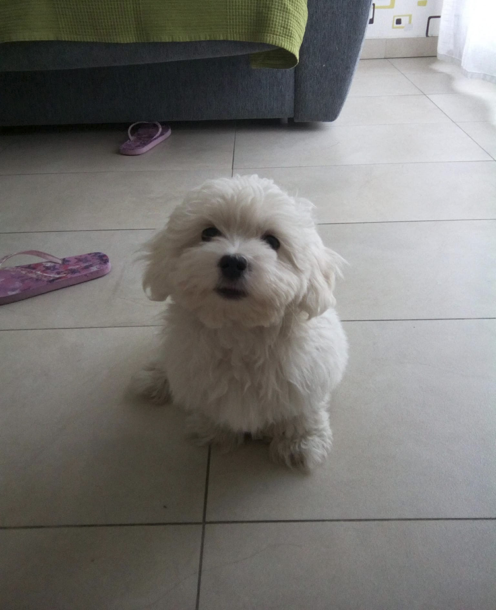

# Introducción sobre Lucía Vignolo Casado

¡Buenos días a todos! Soy Lucía Vignolo Casado, ¿Qué tal se encuentran? Espero que muy bien... Soy Lucía, tengo 19 años y soy estudiante del Grado Superior de Administración de Sistemas Informáticos en Red (ASIR). 

## 1. Cosas sobre mí

Mis comidas favoritas son **la pasta, las croquetas de jamón y la tarta de queso**, y mis hobbies son *el voleibol, el gimnasio, viajar y salir con mis amigos*. La clave de mi candado para el gimasio es la fecha de mi cumpleaños `09052007`

## 2. La calculadora de notas que programé

Para no tener que calcular a mano si he aprobado o no la evaluación, me he hecho este pequeño programa en Python para sacar las notas medias del trimestre:

```python
# Mi calculadora casera para ver si apruebo
notas_trimestre = [8.5, 4.0, 7.2, 6.4]
media = sum(notas_trimestre) / len(notas_trimestre)

print(f"Tu nota media actual es: {media}")
if media >= 5:
    print("¡APROBADO!")
else:
    print("Toca estudiar un poco más...")
```

## 3. Organización de la semana

### Un día conmigo (Lista ordenada)
1. Despertarme a las 07:15.
2. Desayunar algo rápido, vestirme y prepararme para salir.
3. Coger el metro e ir a clase.
4. Salir de clase e ir a comer a casa.
5. Estudiar o avanzar tareas de clase.
6. Entrenamiento de voleibol de 19.00 a 21.15.

### Lo imprescindible en mi bolso de clase (Lista desordenada)
- Mi portátil (fundamental ya que es mi herramienta principal de trabajo)
- Mi cuaderno de apuntes y mi agenda.
- Mis gafas de ver.
- Mi neceser multicosas (pañuelos, chicles, llaves, tiritas...).
- Una botella de agua.

## 4. Enlaces de interés

- **Recurso externo**: Para escuchar música utilizo siempre [Spotify Web](https://open.spotify.com).
- **Información complementaria**: Puedes ver una recomendación personal de series y películas en [mis series y películas favoritas](docs/detalles.md).

## 5. Sección de fotos

### Mi mascota Stich (Imagen Local)
Aquí tenéis una foto de mi perro, cuando era un cachorro:



### Fachada de mi instituto (Imagen Externa)
Aquí añado una fotografía exterior de nuestro instituto (el IES Clara del Rey) enlazada directamente desde los servidores de Wikimedia Commons:


## 6. Control de asignaturas y dificultad

| Asignatura | Horas a la semana | Nivel de estrés (1-5) |
| :--- | :--- | :--- |
| Sistemas Gestores de Bases de Datos | 4 horas | 2 (bastante entretenida) |
| Servicios de red e Internet | 8 horas | 5 (salen muchos errores haciendo las prácticas) |
| Administración de Sistemas Operativos | 6 horas | 3 (mucha teoría que memorizar) |
| Implantación de servicios Web | 4 horas | 1 (damos cosas muy dinámicas y entretenidas) |

## 7. Curiosidades y notas técnicas

<details>
<summary>▶ Pulsa aquí para ver comandos que uso a diario como estudiante de ASIR</summary>

Estos son algunos de los comandos que más repito en la terminal:
* `ip a`: Para comprobar rápidamente las interfaces de red configuradas.
* `ping -c 4 8.8.8.8`: Para verificar conectividad básica hacia el exterior.
* `sudo systemctl status`: Para ver si un servicio web o de red se ha caído.
* `sudo apt update`: Para actualizar la lista de repositorios y los paquetes del sistema.
* `chmod +x script.sh`: Para dar permisos de ejecución a los scripts que vamos creando en clase.
</details>